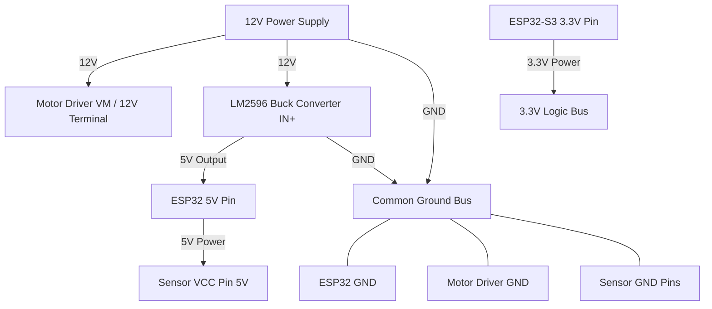
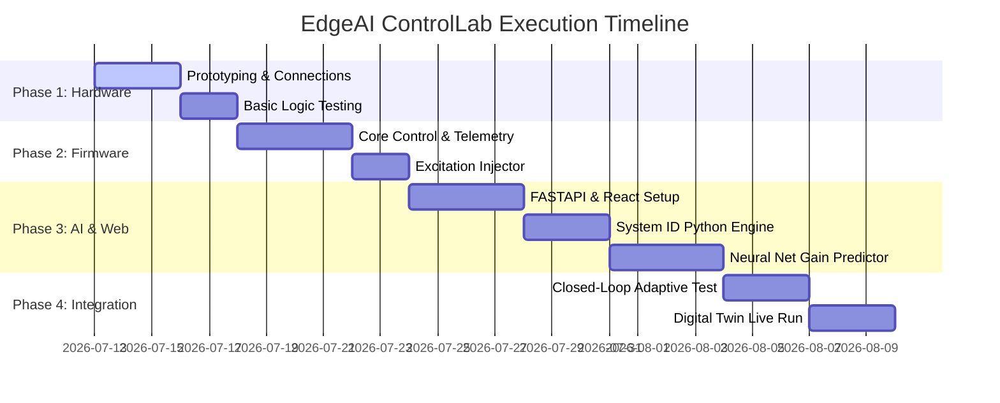

# **EdgeAI ControlLab: Final Execution & Hardware Integration Plan**

This document serves as the comprehensive blueprint for the physical implementation, wiring schematics, and execution phases of the **EdgeAI ControlLab** platform. It provides an exhaustive list of hardware components, exact point-to-point connections, and safety precautions.

For the initial high-level overview, refer to [Plan.md](file:///Users/pratikkumar/Desktop/SEM5%20Projects/EdgeAI%20ControlLab/Plan.md).

---

## **1. Hardware Bill of Materials (BOM)**

This is the comprehensive list of components required to build the universal adaptive control platform.

| Component Name | Technical Specifications | Purpose in Project | Notes |
| :--- | :--- | :--- | :--- |
| **ESP32-S3 DevKit** | ESP32-S3-WROOM-1 (N16R8 recommended: 16MB Flash, 8MB PSRAM) | Central microcontroller, running real-time control loop and serving WebSockets. | Handles DSP, local calculations, and dual-core tasks. |
| **DC Motor with Encoder** | 12V JGA25-370 (or equivalent) with integrated Hall effect quadrature encoder (11 PPR, 341.2 CPR after gear reduction). | The physical plant to be controlled (speed/position control). | Encoder output is used for closed-loop feedback. |
| **TB6612FNG Driver** | Dual H-Bridge, 1.2A constant current per channel (3.2A peak), operates at 2.7V–5.5V logic. | Recommended motor driver. Controls motor direction and speed (PWM). | Highly efficient, runs cool, native 3.3V logic compatibility. |
| **L298N Driver Module** | Dual H-Bridge, 2A constant current per channel, operates at 5V logic. | Alternative motor driver. Heavy and bulky, but widely available. | Requires common ground. Drops ~2V internally. |
| **INA219 current sensor** | I2C interface, high-side current/voltage monitoring, up to 26V and ±3.2A. | Monitors motor current and power draw for fault diagnostics. | Connects to shared I2C bus. Default I2C address `0x40`. |
| **MPU6050 IMU** | 3-axis accelerometer and 3-axis gyroscope. I2C interface. | Optional plant feedback (e.g., if motor runs an inverted pendulum or gimbal). | Connects to shared I2C bus. Default I2C address `0x68`. |
| **DS18B20 Temp Sensor** | 1-Wire interface, waterproof probe, operating range -55°C to 125°C. | Thermal chamber simulation or temperature control plant. | Requires a 4.7kΩ pull-up resistor between VCC and Data. |
| **HC-SR04 Ultrasonic** | 4-pin (VCC, Trig, Echo, GND), operating range 2cm to 400cm. | Water tank level simulator or distance tracking plant. | Echo line (5V) requires a voltage divider (1kΩ/2kΩ) to protect ESP32. |
| **OLED Display** | SSD1306 128x64 pixels, I2C interface. | Local system state display (IP address, PID gains, current error). | Connects to shared I2C bus. Default I2C address `0x3C`. |
| **LM2596 Buck Converter** | DC-DC Step-Down, Input: 4.5V–40V, Output: adjustable (set to 5.0V). | Powers ESP32 5V pin and sensor logic VCC from the 12V source. | Ensure output is tuned to exactly 5.0V *before* connecting. |
| **12V DC Power Supply** | 12V DC, 2A–5A wall adapter or desktop power supply. | Primary power source for the motor, driver, and buck converter. | Provides stable power for high-torque motor maneuvers. |
| **Breadboard & Wires** | Half-size/Full-size breadboards, solid-core jumper wires, Dupont wires. | Circuit prototyping and connecting modules together. | Use short leads to minimize electromagnetic interference. |
| **Resistors** | 1x 4.7kΩ (for DS18B20), 1x 1kΩ & 1x 2kΩ (for HC-SR04 Echo). | Pull-up and voltage divider protection. | Essential for logic level conversion. |

---

## **2. ESP32-S3 Pin Allocation Matrix**

All inputs and outputs are mapped to prevent pin conflicts. Bootstrapping and native USB pins are avoided to maintain system stability.

| GPIO Pin | Function | Hardware Connection | Pin Type | Notes |
| :--- | :--- | :--- | :--- | :--- |
| **GPIO 4** | I2C SDA | OLED SDA, INA219 SDA, MPU6050 SDA | Bidirectional | Shared I2C bus (requires external 4.7kΩ pull-ups if not built into modules). |
| **GPIO 5** | I2C SCL | OLED SCL, INA219 SCL, MPU6050 SCL | Output | Shared I2C bus. |
| **GPIO 6** | Quadrature Enc A | Motor Encoder Yellow/Green wire | Input | Configured with internal pull-up. Interrupt-driven (Phase A). |
| **GPIO 7** | Quadrature Enc B | Motor Encoder Green/Yellow wire | Input | Configured with internal pull-up. Interrupt-driven (Phase B). |
| **GPIO 10**| One-Wire Data | DS18B20 DQ (Data pin) | Bidirectional | Requires external 4.7kΩ pull-up resistor to 3.3V. |
| **GPIO 11**| Trigger Output | HC-SR04 Trig Pin | Output | Direct connection (3.3V logic is enough to trigger the sensor). |
| **GPIO 12**| Echo Input | HC-SR04 Echo Pin | Input | Connects through 1kΩ / 2kΩ voltage divider to step 5V down to 3.3V. |
| **GPIO 15**| Motor Speed (PWM) | TB6612 PWMA / L298N ENA | Output | LEDC PWM channel configured for 20 kHz frequency. |
| **GPIO 16**| Motor Direction 1 | TB6612 AIN1 / L298N IN1 | Output | Control direction of H-Bridge. |
| **GPIO 17**| Motor Direction 2 | TB6612 AIN2 / L298N IN2 | Output | Control direction of H-Bridge. |
| **GPIO 18**| Standby/Enable | TB6612 STBY (only) | Output | Pull HIGH to enable H-Bridge. Not needed for L298N. |

> [!WARNING]
> **Avoided Pins:** GPIO 0, 45, and 46 are not used because they are bootstrap pins that determine boot mode (flashing vs. SPI boot). GPIO 19 and 20 are reserved for USB JTAG/Console connections.

---

## **3. Point-to-Point Connection Wiring Guide**

### **3.1. Power Distribution Circuit**
Every ground must be tied together (Common Ground) to provide a stable reference potential for the control signals.



#### **Power Connection Table**
| Source Component | Pin/Terminal | Target Component | Pin/Terminal | Wire Purpose |
| :--- | :--- | :--- | :--- | :--- |
| **12V DC Adapter** | positive (+) | **LM2596 Buck** | IN+ | Main raw power input |
| **12V DC Adapter** | negative (-) | **LM2596 Buck** | IN- | Raw ground input |
| **12V DC Adapter** | positive (+) | **Motor Driver** | VM / 12V Terminal | High current motor power |
| **LM2596 Output** | OUT+ (tuned to 5V) | **ESP32 DevKit** | 5V / VIN | Microcontroller power |
| **LM2596 Output** | OUT- | **Breadboard GND**| GND Bus (Common Ground)| Common reference |
| **ESP32 DevKit** | GND | **Breadboard GND**| GND Bus | Ties microcontroller logic ground |
| **ESP32 DevKit** | 3.3V | **Breadboard 3.3V**| 3.3V Bus | Logic power for low-power sensors |

---

### **3.2. Motor Control Configurations**
Choose the wiring guide below corresponding to your selected motor driver.

#### **Option A: Wiring with TB6612FNG Driver (Recommended)**
The TB6612FNG uses logic pins on one side and power outputs on the other.

| TB6612FNG Pin | Connects to | Target Component | Pin/Terminal | Wire Purpose |
| :--- | :--- | :--- | :--- | :--- |
| **VM** | Pin 1 | **Power Supply** | 12V Positive (+) | Motor supply voltage (12V) |
| **VCC** | Pin 2 | **Breadboard 3.3V**| 3.3V Bus | Logic voltage supply |
| **GND** | Pin 3 | **Breadboard GND**| GND Bus | Common Ground |
| **AO1** | Pin 4 | **DC Motor** | Terminal 1 (Motor +) | H-Bridge Output A1 |
| **AO2** | Pin 5 | **DC Motor** | Terminal 2 (Motor -) | H-Bridge Output A2 |
| **PWMA** | Pin 10 | **ESP32-S3** | GPIO 15 | PWM duty cycle (speed control) |
| **AIN2** | Pin 11 | **ESP32-S3** | GPIO 17 | Direction control logic input 2 |
| **AIN1** | Pin 12 | **ESP32-S3** | GPIO 16 | Direction control logic input 1 |
| **STBY** | Pin 13 | **ESP32-S3** | GPIO 18 (or 3.3V) | Standby (HIGH = Active, LOW = Standby)|
| **GND** | Pin 14 | **Breadboard GND**| GND Bus | Logic ground return |

#### **Option B: Wiring with L298N Driver Module**
Note that L298N modules usually include an onboard 5V regulator. If powered by 12V, you can keep the 5V jumper on, which makes the 5V terminal act as an *output* to power the ESP32.

| L298N Terminal | Connects to | Target Component | Pin/Terminal | Wire Purpose |
| :--- | :--- | :--- | :--- | :--- |
| **12V** | Screw Term | **Power Supply** | 12V Positive (+) | Motor power input |
| **GND** | Screw Term | **Breadboard GND**| GND Bus | Common Ground |
| **5V** | Screw Term | **ESP32 DevKit** | 5V / VIN (if no buck)| 5V Power Output (if Jumper is on) |
| **OUT1** | Screw Term | **DC Motor** | Terminal 1 (Motor +) | Motor drive phase A |
| **OUT2** | Screw Term | **DC Motor** | Terminal 2 (Motor -) | Motor drive phase B |
| **ENA** | Pin Header | **ESP32-S3** | GPIO 15 | Speed control (Remove jumper first) |
| **IN1** | Pin Header | **ESP32-S3** | GPIO 16 | Direction input 1 |
| **IN2** | Pin Header | **ESP32-S3** | GPIO 17 | Direction input 2 |

---

### **3.3. Quadrature Motor Encoder Wiring**
The encoder measures rotation speed and direction. It operates at 3.3V logic.

| Encoder Wire Color | Function | Target Component | Pin/Terminal | Notes |
| :--- | :--- | :--- | :--- | :--- |
| **Red** | Encoder VCC | **Breadboard 3.3V**| 3.3V Bus | Powers internal Hall effect ICs |
| **Black** | Encoder GND | **Breadboard GND**| GND Bus | Sensor ground reference |
| **Yellow** | Encoder Phase A | **ESP32-S3** | GPIO 6 | High-speed interrupt pin |
| **Green** | Encoder Phase B | **ESP32-S3** | GPIO 7 | Direction reference pin |
| **Blue / White** | Motor Power + | **Motor Driver** | AO1 / OUT1 | Driver H-Bridge output A |
| **White / Red** | Motor Power - | **Motor Driver** | AO2 / OUT2 | Driver H-Bridge output B |

---

### **3.4. Shared I2C Sensor Bus (OLED, INA219, MPU6050)**
All three devices reside on the exact same two pins. The ESP32 communicates with them individually using their unique hex addresses.

| Shared Bus Pin | ESP32-S3 Connection | Sensor Pin | Address | Notes |
| :--- | :--- | :--- | :--- | :--- |
| **SDA** | **GPIO 4** | OLED SDA, INA219 SDA, MPU6050 SDA | Multiple | Serial Data line |
| **SCL** | **GPIO 5** | OLED SCL, INA219 SCL, MPU6050 SCL | Multiple | Serial Clock line |
| **VCC** | **3.3V Bus** | OLED VDD, INA219 VCC, MPU6050 VCC | N/A | Pull-ups hook up to this rail |
| **GND** | **GND Bus** | OLED GND, INA219 GND, MPU6050 GND | N/A | Signal ground return |

*   **Addresses:** OLED: `0x3C`, INA219: `0x40`, MPU6050: `0x68`.

---

### **3.5. DS18B20 Temperature Sensor Wiring**
The 1-Wire bus requires a specific pull-up resistor to pull the data line to VCC when idle.

```text
       3.3V Rail ────────┬────────────────────────
                         │
                       [4.7kΩ]  <-- Pull-Up Resistor
                         │
   ESP32 GPIO 10 ────────┼─── (DS18B20 Yellow Data wire)
                         │
        GND Rail ────────┴─── (DS18B20 Black/Blue GND wire)
```

| DS18B20 Wire Color | Function | Target Component | Pin/Terminal | Notes |
| :--- | :--- | :--- | :--- | :--- |
| **Red** | VCC | **Breadboard 3.3V**| 3.3V Bus | Power source |
| **Black / Blue** | GND | **Breadboard GND**| GND Bus | Common ground |
| **Yellow / Green** | DQ (Data) | **ESP32-S3** | GPIO 10 | 1-Wire signal line |

---

### **3.6. HC-SR04 Ultrasonic Sensor (Level Tracking)**
Because the standard HC-SR04 outputs a 5V pulse on the Echo pin, we must use a **resistive voltage divider** to step the logic level down to 3.3V before feeding it to ESP32's GPIO 12.

```text
HC-SR04 Echo Pin (5V Out) ────[ 1kΩ Resistor ]────┬────> ESP32 GPIO 12 (3.3V Input)
                                                  │
                                            [ 2kΩ Resistor ]
                                                  │
GND Rail ─────────────────────────────────────────┴────> Common Ground (GND)
```

#### **Ultrasonic Sensor Connection Table**
| HC-SR04 Pin | Connects to | Target Component | Pin/Terminal | Notes |
| :--- | :--- | :--- | :--- | :--- |
| **VCC** | Direct | **Buck Converter** | 5V OUT | Requires 5V to power transceiver |
| **Trig** | Direct | **ESP32-S3** | GPIO 11 | Trigger pulse (3.3V logic is OK) |
| **Echo** | Through Divider | **Voltage Divider** | 1kΩ Resistor Input | Echo pulse (Output is 5V) |
| **GND** | Direct | **Breadboard GND**| GND Bus | Common ground |

---

### **3.7. Physical Placement & Sensor Mounting Layout**

The physical arrangement of sensors relative to the motor and the testbed structure is critical for accurate measurements and safe operation.


```text
PHYSICAL TESTBED LAYOUT:

                       [Static Sensor Tower]
                       +-------------------+
                       |   HC-SR04 (Sonar) |
                       |    [Trig]   [Echo]|
                       +---------+---------+
                                 │
                                 ▼ (ultrasonic beam)
                                 │
   +─────────────────────────────┼──────────────────────────────+
   | Testbed Base                ▼                              |
   |                       +───────────+                        |
   |                       |  Target   | (e.g. carriage/piston/ |
   |                       |  Surface  |  water level plate)    |
   |                       +─────┬─────+                        |
   |                             ▲                              |
   |                             │ (linkage/coupling)           |
   |                             │                              |
   |                       +─────┴─────+                        |
   |                       |  DC Motor |                        |
   |                       | ┌────────┐|                        |
   |                       | │DS18B20 │| <-- Temp Sensor strapped to casing
   |                       | └────────┘|                          with thermal tape
   |                       +─────┬─────+                        |
   |                             │                              |
   |                       +─────┴─────+                        |
   |                       |  MPU6050  | <-- IMU screwed to mounting bracket
   |                       |  (IMU)    |     for vibration analysis
   |                       +─────┬─────+                        |
   |                             │                              |
   |                       +─────┴─────+                        |
   |                       |  Encoder  | <-- Quadrature Encoder (rigidly on 
   |                       |  Module   |     the back-shaft of the motor)
   |                       +───────────+                        |
   |                                                            |
   |  [Control Console / Breadboard]                            |
   |  +──────────────────────────────────────────────────────+  |
   |  | ESP32-S3       TB6612FNG       INA219       OLED     |  |
   |  +──────────────────────────────────────────────────────+  |
   |                                                            |
   +────────────────────────────────────────────────────────────+
```

#### **Mounting Details & Spatial Arrangement**
1. **Quadrature Encoder (Speed/Position):**
   - **Mounting:** Rigidly and permanently attached to the rear shaft of the DC motor.
   - **Alignment:** Aligned inside the motor case. It must not be modified or moved since it relies on precise alignment with the magnetic ring on the shaft.
2. **Temperature Sensor (DS18B20):**
   - **Mounting:** Strapped directly onto the outer metal cylindrical body of the DC motor using a zip-tie or heat-resistant thermal tape.
   - **Alignment:** In direct contact with the motor casing (ideally with a dab of thermal paste) to monitor core temperature rise under heavy control actions.
3. **IMU Sensor (MPU6050):**
   - **Mounting:** Screwed or rigidly glued to the motor's structural mounting bracket or chassis.
   - **Alignment:** Parallel to the motor's axis of rotation. This placement is vital for capturing vibration frequency/displacement along the X, Y, and Z axes for the fault diagnostics module.
4. **Ultrasonic Sensor (HC-SR04):**
   - **Mounting:** Placed on a static support stand **facing** the moving part of the load (e.g., pointing directly at the carriage if the motor drives a linear slide, or pointing downwards from the top lid of a water tank if controlling level).
   - **Alignment:** Perpendicular to the target flat plate surface. It must have an unobstructed line-of-sight to prevent false echo readings.
5. **Current Sensor (INA219) & OLED:**
   - **Mounting:** Placed on the main prototyping breadboard or control console, away from physical motor vibration.

---

## **4. Step-by-Step Execution Plan**



### **Phase 1: Hardware Assembly & Basic Logic Test**
1. **Set Up Power Rails:** Wire the 12V adapter to the LM2596 buck converter. Adjust the converter potentiometer until its output measures exactly 5.0V.
2. **Mount the ESP32-S3:** Place the ESP32-S3 on the breadboard. Connect LM2596 5V output to the ESP32 5V/VIN pin, and tie grounds together.
3. **Assemble Motor Driver:** Wire the TB6612FNG or L298N according to the pinout. Confirm that turning on 12V doesn't bootloop the ESP32.
4. **Test Basic Directionality:** Write a simple sketch to drive the motor forward at 30% duty cycle for 2 seconds, stop, and reverse.
5. **Verify Encoder Functionality:** Rotate the motor axle by hand and print encoder pulses via the Serial Monitor to ensure Phase A and Phase B count up/down correctly.

### **Phase 2: Firmware Architecture & Real-Time Control**
1. **Interrupt Service Routine (ISR):** Implement a high-speed interrupt handler for GPIO 6 and 7 to calculate current speed (RPM) or position (radians).
2. **Fixed-Frequency Control Loop:** Set up a hardware timer interrupt (e.g., at 100 Hz or 10 ms interval) to execute the PID calculation. Avoid using `delay()` inside loops.
3. **Serial/Websocket Commands:** Program commands to change PID constants ($K_p$, $K_i$, $K_d$) or reference target (setpoint) dynamically.
4. **Safety Watchdog:** Program safety interrupts: if the current sensor (INA219) exceeds 2.0A, shut down motor output immediately.

### **Phase 3: System Identification & Signal Injection**
1. **Excitation Signal Generator:** Write routines inside the firmware to perform **step responses** (instant change from 0% to 50% PWM) and **sine sweeps/chirps** (varying frequency PWM input).
2. **Telemetry Streaming:** Stream the timestamp, PWM input, and speed output over WebSockets at high speed (100 Hz).
3. **Data Collector Script:** Write a python script on the PC that opens a WebSocket connection to the ESP32, commands an excitation run, gathers the output time-series, and saves it to a `.csv` file.

### **Phase 4: AI/ML Module Development**
1. **System Identification Engine:** Use Python (`scipy.optimize` or `control` library) to fit a transfer function ($G(s) = \frac{K}{\tau s + 1}$ or $G(s) = \frac{K \omega_n^2}{s^2 + 2\zeta\omega_n s + \omega_n^2}$) using the gathered `.csv` data.
2. **Gain Predictor Training:** 
   - Simulate 10,000 systems with randomized parameters ($K$, $\tau$, $\zeta$, $\omega_n$, time delay).
   - Use optimization algorithms (e.g., LQR, ITAE minimization) to find optimal gains ($K_p, K_i, K_d$).
   - Train a Scikit-learn Random Forest Regressor or a simple Keras Multi-Layer Perceptron using ($K, \tau, \zeta, \text{etc.}$) as inputs and ($K_p, K_i, K_d$) as outputs.
3. **Model Validation:** Save the trained model parameters (weights or trees) for execution in the backend FastAPI server.

### **Phase 5: Web Platform & Digital Twin Development**
1. **FastAPI Backend:** Create endpoints to trigger experiments, store results in SQLite/PostgreSQL, run the AI System ID model, and predict gains.
2. **React Dashboard:**
   - **Visualizer:** Plot reference, control input, and error using Chart.js or Plotly.js.
   - **Digital Twin:** Render a 3D model of the motor/tank rotating or filling in real time using Three.js based on telemetry data.
   - **Math Display:** Draw Pole-Zero maps, Bode plots, and Root Locus lines computed by the backend control library.
3. **WebSocket Bridge:** Establish real-time JSON message exchange between ESP32, Backend, and Frontend.

### **Phase 6: Integration, Fault Diagnosis & Tuning**
1. **Adaptive Tuning Loop:** Integrate the entire pipeline: 
   - Web App commands step excitation -> ESP32 executes and sends telemetry -> Backend fits Transfer Function -> AI model predicts optimal gains -> Web App uploads new gains to ESP32 -> System runs under new controller.
2. **Fault Diagnostic Training:** Introduce system perturbations (e.g., hold motor shaft to simulate overload, apply brake to simulate high friction). Record current/vibration patterns.
3. **Fault Classifier:** Implement a lightweight classifier (decision tree or SVM) to output diagnostic alerts on the dashboard ("Warning: Motor Overload Detected").
4. **Final System Validation:** Test the self-tuning capabilities under varying plant conditions (e.g. changing mechanical load) and generate complete execution reports.
